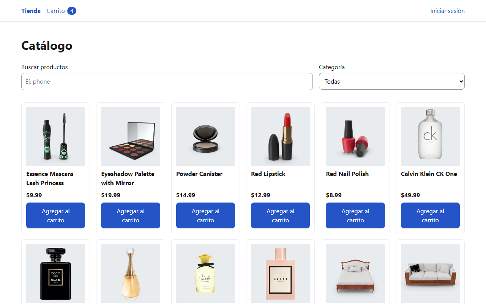
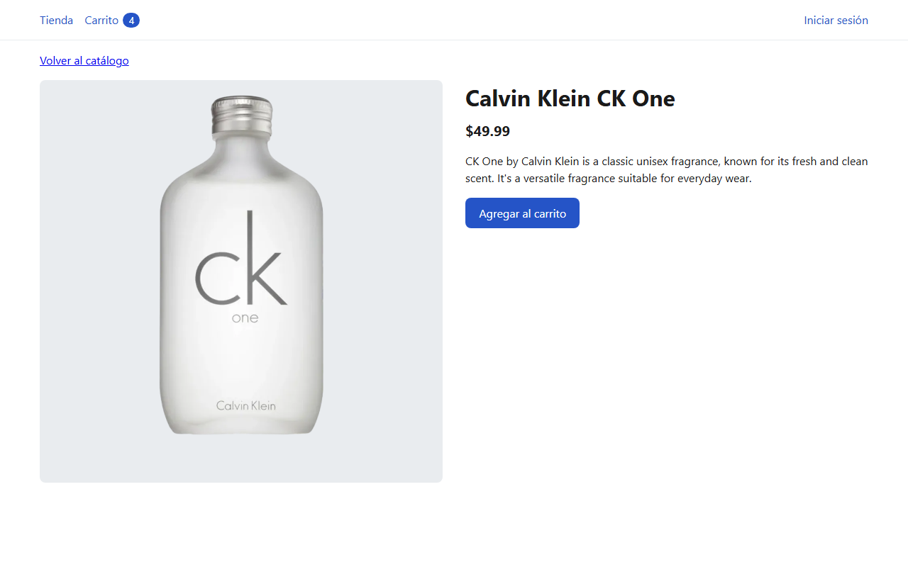
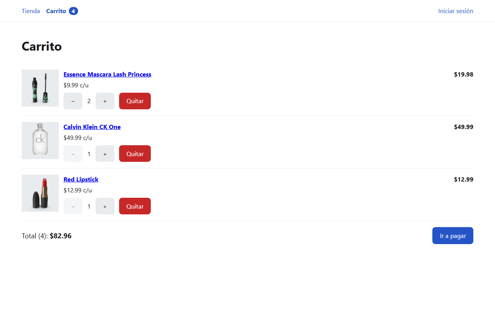
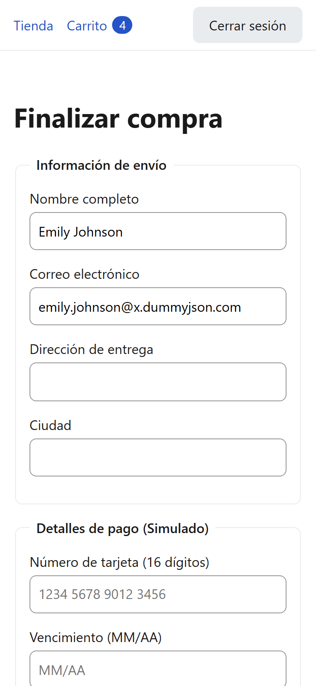

# E-commerce Vue

Tienda en línea hecha con Vue 3 para la materia Manejo de Frameworks (URU). Es solo frontend: los productos y el inicio de sesión vienen de la API pública [DummyJSON](https://dummyjson.com).



## Funcionalidades

| Requisito del enunciado                                                     | Cómo está resuelto                                                                                                                                                              |
| --------------------------------------------------------------------------- | ------------------------------------------------------------------------------------------------------------------------------------------------------------------------------- |
| Catálogo con scroll infinito y carga progresiva de imágenes                 | La lista pide 20 productos más al acercarse al final (`IntersectionObserver`). Cada imagen se carga solo cuando está por aparecer en pantalla y entra con un fundido.           |
| Búsqueda de productos y filtros por categoría                               | Búsqueda que espera a que el usuario deje de escribir antes de consultar, filtro por categoría y combinación de ambos.                                                          |
| Vista de detalle de cada producto                                           | Imagen, nombre, precio, descripción y botón para agregar al carrito. Maneja los casos de cargando, error y producto inexistente.                                                |
| Carrito: agregar y quitar productos, cambiar cantidades y total actualizado | Contador en el encabezado, botones + y −, subtotal por producto y total. El carrito se conserva al recargar la página.                                                          |
| Inicio y cierre de sesión                                                   | Formulario con validación contra la API de DummyJSON. La sesión se conserva al recargar y el checkout solo es accesible con sesión iniciada.                                    |
| Formulario de compra simulado con validación                                | Nombre, correo, dirección, ciudad, tarjeta, vencimiento y CVV, cada uno con su validación. Al confirmar se muestra el número de pedido y se vacía el carrito. No se cobra nada. |

Además, todas las vistas que cargan datos muestran estados de cargando, vacío y error, y la aplicación funciona en celular, tablet y computadora.

## Capturas

| Detalle del producto                                    | Carrito                                                |
| ------------------------------------------------------- | ------------------------------------------------------ |
|  |  |

Checkout en celular, con la sesión del usuario de prueba:



Las capturas se tomaron de la versión de producción (`npm run build` y `npm run preview`).

## Usuario de prueba

Para iniciar sesión y llegar al checkout:

- Usuario: `emilys`
- Contraseña: `emilyspass`

El formulario de compra es simulado: se puede usar cualquier número de tarjeta de 16 dígitos con una fecha de vencimiento futura, por ejemplo `4242 4242 4242 4242`, `12/30` y CVV `123`.

## Requisitos

- Node.js 22.18 o superior (o 24.12 o superior)
- npm
- Git

## Instalación y ejecución

1. Clonar el repositorio:

   ```bash
   git clone https://github.com/jerichd4c/ecommerce-vue.git
   cd ecommerce-vue
   ```

2. Instalar dependencias:

   ```bash
   npm install
   ```

3. Crear el archivo de variables de entorno a partir del ejemplo:

   ```bash
   cp .env.example .env
   ```

   En PowerShell: `Copy-Item .env.example .env`

4. Levantar el servidor de desarrollo:

   ```bash
   npm run dev
   ```

   La aplicación queda en http://localhost:5173

Para probar la versión de producción: `npm run build` y luego `npm run preview`.

## Comandos

| Comando             | Para qué sirve                               |
| ------------------- | -------------------------------------------- |
| `npm run dev`       | Servidor de desarrollo                       |
| `npm run build`     | Genera la versión de producción en `dist/`   |
| `npm run preview`   | Sirve la versión de producción para probarla |
| `npm run test:unit` | Ejecuta las pruebas                          |
| `npm run lint`      | Revisa y corrige el estilo del código        |
| `npm run format`    | Formatea el código con Prettier              |

## Tecnologías

- Vue 3 (Composition API con `<script setup>`)
- Vite
- Vue Router
- Pinia
- Vitest y Vue Test Utils
- ESLint, oxlint y Prettier

## Estructura del proyecto

El código está organizado por funcionalidad: cada parte de la tienda vive en su propio módulo.

```
src/
  modules/
    catalog/      lista de productos, scroll infinito, búsqueda y filtros
    product/      vista de detalle de un producto
    cart/         carrito de compras
    auth/         inicio y cierre de sesión, protección de rutas
    checkout/     formulario de compra simulado
  shared/         componentes base, cliente de la API y funciones de ayuda
  router/         une las rutas de todos los módulos
  assets/         estilos globales
```

La arquitectura, las convenciones de código y el flujo de trabajo del equipo están explicados en [CONTRIBUTING.md](CONTRIBUTING.md).

## Accesibilidad y adaptación a pantallas

Revisión final hecha sobre todas las pantallas (catálogo, detalle, carrito vacío y con productos, login con errores, checkout con errores, confirmación y 404):

- Cada página tiene su propio título en la pestaña (por ejemplo, "Carrito | Ecommerce Vue"). En el detalle, el título es el nombre del producto.
- Al cambiar de página, el foco pasa al contenido principal para que el teclado y el lector de pantalla sigan desde ahí.
- Enlace "Saltar al contenido" al inicio de cada página.
- Un solo `<h1>` por página y sin saltos de nivel en los encabezados.
- Todas las imágenes con texto alternativo y todos los campos con su etiqueta.
- Errores de formulario asociados a su campo (`aria-invalid` y `aria-describedby`) y foco en el primer campo con error.
- Contraste de texto de al menos 4.5:1 en todas las pantallas.
- Sin desbordes horizontales en 320, 375, 768 y 1280 px de ancho.

## Pruebas

83 pruebas con Vitest y Vue Test Utils, que cubren los stores del carrito, la sesión y el detalle; las vistas de login, detalle, carrito y checkout; el encabezado; el guard de autenticación; las validaciones del checkout y los títulos de página.

```bash
npm run test:unit
```

Las pruebas no dependen de la red: las llamadas a la API se simulan con `vi.mock`.

## Equipo

| Integrante       | GitHub                                              | Módulos                                                |
| ---------------- | --------------------------------------------------- | ------------------------------------------------------ |
| Sebastián Cohen  | [jerichd4c](https://github.com/jerichd4c)           | Catálogo, estructura del proyecto y revisión de código |
| Jesús Quintero   | [JesusQG](https://github.com/JesusQG)               | Inicio de sesión y checkout                            |
| Gianpaolo Strada | [GianpaoloStrad](https://github.com/GianpaoloStrad) | Detalle del producto, carrito y encabezado             |
